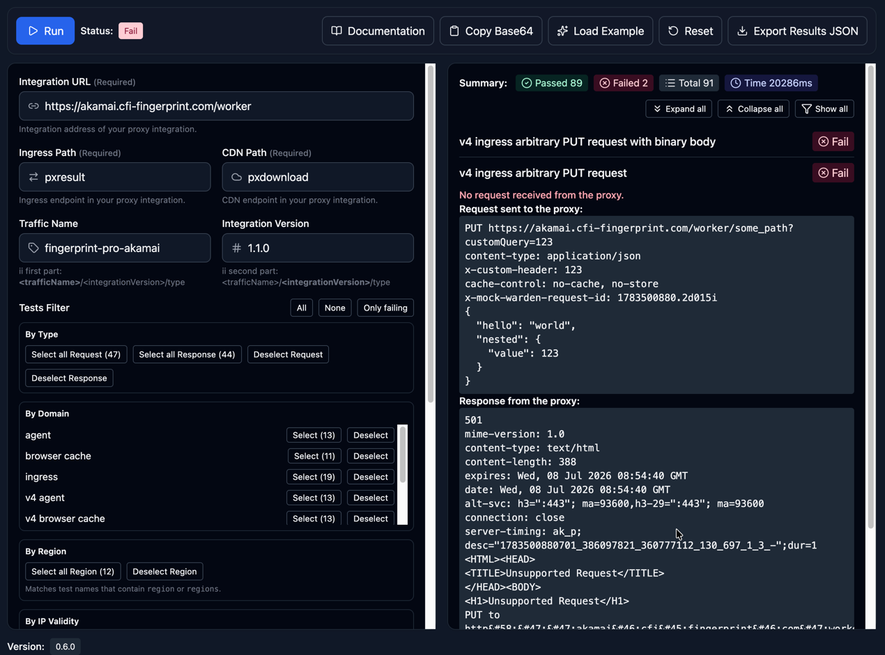

# dx-team-mock-for-proxy-integrations-e2e-tests

> **Note**
> This repository isn’t part of our core product, it's a part of our internal tools.

This repository contains a mock server that is used for advanced E2E tests for our proxy integrations.
When the integration is properly configured, it allows us to inspect requests sent from these integrations and perform necessary assertions.


## Preparation

In order to test your proxy integration, you need to configure it to send requests to this mock app.
In most cases, this can be done by setting this ENV variable when building the integration: `INGRESS_API`. For example:

```bash
INGRESS_API=<API_URL> pnpm run build
```

You also need to set `secret` as your proxy secret key.

Refer to specific integration README for more details.

> **Note**
> In order to get the API URL, contact the DX team.

## How to use it

### UI

If you navigate to the mock app URL, you will see a simple UI that allows you to run the tests.


Use the **Region** select to run the region tests for `us`, `eu`, `ap` or `all` regions (default). When you test an integration that targets a single region, pick that region so the other regions do not fail the run.


### REST API

This app exposes a REST API that can be used to run the tests.

To run tests, send a `POST` request to: `/api/test/run-tests` with the following payload:
```json
{
  // Base origin of your proxy integration
  "integrationUrl": "https://mock-test-inter-568-mock-app-tests.cfi-fingerprint.com/worker/",
  // (Optional) CDN path in your proxy integration
  "cdnPath": "pxdownload",
  // (Optional) Ingress path in your proxy integration
  "ingressPath": "pxresult",
  // First part of ii parameter sent by our proxy integration: <trafficName>/<integrationVersion>/type
  "trafficName": "fingerprint-pro-akamai",
  // Second part of ii parameter sent by our proxy integration: <trafficName>/<integrationVersion>/type
  "integrationVersion": "1.0.1-snapshot.0",
  // (Optional) filters
  "include": ["ingress", "agent*", "/body integrity protected with \\d{3} status code$/i"],
  // (Optional) filters
  "exclude": ["query params", "ipv6"],
  // (Optional) flag to run new tests suite for API V4
  "enableV4Tests": false,
  // (Optional) region to check in region tests: "us", "eu", "ap" or "all" (default)
  "region": "all"
}
```

You will receive the following response:
```json
{
  "host": "https://mock-test-inter-568-mock-app-tests.cfi-fingerprint.com",
  "status": "finished",
  "results": [
    {
      // True if the test passed
      "passed": true,
      // Name of the test
      "testName": "agent request query params",
      // Duration of the request in milliseconds
      "requestDurationMs": 322
    },
    {
      // False if the test failed
      "passed": false,
      // Name of the test
      "testName": "ingress request headers",
      // Duration of the request in milliseconds
      "requestDurationMs": 23,
      // Assertion that failed
      "reason": "customQuery",
      "meta": {
        "error": {
          "generatedMessage": false,
          "code": "ERR_ASSERTION",
          "actual": "123",
          "expected": "1234",
          "operator": "assert"
        },
        // Record of requests that we received from proxy for this test, grouped by type (cdn, ingress, cache)
        "requestsFromProxy": {
          "ingress": [
            {
              // URL from our app that proxy sent request to
              "url": "/worker/pxresult",
              // Request headers
              "headers": {},
              // Request method
              "method": "POST"
            }
          ],
          "cdn": [],
          "cache": []
        }
      }
    }
  ]
}
```

### CLI

As an alternative, you can use our CLI client:
```bash
pnpm dlx "git+https://github.com/fingerprintjs/dx-team-mock-for-proxy-integrations-e2e-tests.git" -- \
# URL of the mock server 
--api-url="<API_URL>" \
# Base URL of your integration
--integration-url="https://mock-test-inter-568-mock-app-tests.cfi-fingerprint.com/worker/" \
# CDN path in your proxy integration 
--cdn-path="pxdownload" \
# Ingress path in your proxy integration
--ingress-path="pxresult" \
# First part of ii parameter sent by our proxy integration: <trafficName>/<integrationVersion>/type
--traffic-name="fingerprint-pro-akamai" \
# Second part of ii parameter sent by our proxy integration: <trafficName>/<integrationVersion>/type
--integration-version="1.0.1-snapshot.0" \
# (Optional) Include tests by case-insensitive substring matching (if omitted, all tests are included)
--include="agent request" \
# (Optional) Glob-lite matching (* any sequence, ? any single char)
--include="agent*" \
# (Optional) RegEx literal: /pattern/flags
--include="/body integrity protected with \d{3} status code$/i" \
# (Optional) Exclude tests (same matching rules as include)
--exclude="ipv6" \
# (Optional) Runs new tests suite for API V4
--enable-new-tests=true \
# (Optional) Region to check in region tests: us, eu, ap or all (default)
--region="eu"
```

## Adding new tests

Test cases can be found in [src/app/test/cases](src/app/test/cases) directory, and look like this:
```ts
import { assert, assertToBeTruthy } from '../../service/assert'
import { TestCase } from '../../types/testCase'

const testCase: TestCase = {
  // Name of the tests
  name: 'agent request preserve header and query',
  // Test function. It receives `api` object that can be used to send requests to the proxy integration.
  test: async (api) => {
    const query = new URLSearchParams()
    query.set('customQuery', '123')

    // `requestFromProxy` is the request that we received from proxy integration.
    const { requestFromProxy } = await api
      // or .sendRequestToIngress which sends request to the ingress endpoint
      // or .sendRequestToCacheEndpoint which sends request to the cache endpoint
      .sendRequestToCdn({ query, request: { headers: { 'X-Custom': '123' } } })
    const { ii, customQuery } = requestFromProxy.query

    assertToBeTruthy('ii', ii)
    assertToBeTruthy('customQuery', customQuery)

    // More assertions
  },
}

export default testCase
```

To add a new test case, simply create a new file in [src/app/test/cases](src/app/test/cases) directory with `*.case.ts` file name and provide a default export with the `TestCase` object.
Start the test name with its endpoint (`agent`, `ingress` or `browser cache`), preceded by `v4 ` for v4 tests, and put `-v4-` in the file name of those: they tag the test's logs, and a unit test checks it.
It will be automatically picked up by the test runner.

## Running locally

1. Clone the repository.
2. Install dependencies: `pnpm install`.
3. Run the app: `pnpm run start:dev`. By default the app will run on port `3000`.
4. Use a tunnel to make the app accessible from the internet. For example, you can use [ngrok](https://ngrok.com/):
    ```bash
    ngrok http 3000
    ```
5. Use the URL provided by ngrok to run the tests. Refer to the [Preparation](#preparation) section for more details.

## Logging

Mock Warden logs one JSON object per line to stdout:

```json
{"timestamp":"2026-01-02T03:04:05.678Z","level":"info","message":"Test finished","service":"mock-warden","version":"0.7.0","integrationHost":"example.com","testName":"agent request preserve header and query","attempt":1,"endpoint":"agent","apiVersion":"v3","event":"test.finished","passed":true,"duration_ms":412,"failed_attempts":0}
```

- Log with the logger from [src/logger](src/logger), not `console.*` (the `no-console` lint rule enforces it): `logger.info('Message', { some: 'fields' })`.
- Lines logged while a test case runs carry `integrationHost`, `testName`, `attempt`, `endpoint` and `apiVersion`.
- Don't name a field `host`, `status`, `source` or `trace_id`: Datadog reserves them, and the tests check it.
- Bodies and headers are logged at `debug` level only, and credential-like keys (`cookie`, `authorization`, `fpjs-proxy-secret`, ...) are redacted.
- Metrics can be built on the `http.request`, `session.started`, `session.finished` and `test.finished` events, which carry `duration_ms`.
- `result.logs` in the `run-tests` response holds the same JSON lines.
- `LOG_LEVEL` is `debug`, `info` (default), `warn` or `error`. `LOG_FORMAT` is `json` or `pretty`: by default `pretty` in a terminal outside production, `json` otherwise.

## Unit tests

```bash
pnpm test
```

Tests live next to the code as `*.test.ts` and run with the built-in `node:test`. `pnpm test` pins `LOG_LEVEL` and `LOG_FORMAT`, as some tests read the JSON logs.

## Using Docker Compose

To run this project using Docker Compose, follow these steps:

1. **Set up Ngrok Authentication**
   - Visit https://dashboard.ngrok.com/get-started/your-authtoken
   - Click the "Copy" button to copy your Ngrok auth token
   - Create a `.env` file in the project root if it doesn't exist
   - Add or update the NGROK_AUTH_TOKEN in the `.env` file:
     ```
     NGROK_AUTH_TOKEN=your_copied_auth_token
     ```

2. **Run Docker Compose**
   - Open a terminal in the project root directory
   - Run the following command to start the containers in detached mode:
     ```
     docker compose up -d --build
     ```
   - This will build the Docker image and start the containers for both the application and Ngrok in the background

3. **Access the Ngrok Tunnel**
   - Once the containers are running, visit https://dashboard.ngrok.com/endpoints
   - You should see your active tunnel listed here, sorted by creation time (most recent first)
   - Use the provided Ngrok URL to access your application through the secure tunnel

4. **Viewing Logs**
   - If you need to view the logs while the containers are running in detached mode, use:
     ```
     docker compose logs -f
     ```
   - This will display the logs and follow them in real-time. Use Ctrl+C to exit the log view.

5. **Updating the Application**
   - If you make changes to the code, the hot module reload may not be sufficient. In such cases, you need to restart the app service using the following command:
     ```
     docker compose up -d --build app
     ```
   - This command will rebuild the app service with your changes and restart it, without affecting the ngrok service


## Releasing

This project uses [changesets](https://github.com/changesets/changesets) to manage `CHANGELOG.md` and releases.

1. In every PR with a user-facing change, add a changeset: `pnpm exec changeset`. Pick `patch`, `minor` or `major` and describe the change. Commit the generated `.changeset/*.md` file.
2. On merge to `main`, the [Release workflow](.github/workflows/release.yml) opens/updates a `Release [changeset]` PR. It bumps the version, updates `CHANGELOG.md` and rebuilds the CLI bundle in `test-runner/dist`.
3. Merging the release PR creates the `vX.Y.Z` git tag and the GitHub release.

The CLI bundle (`test-runner/dist`) is committed because consumers run it straight from git. Rebuild it locally with `pnpm build:test-runner`.
